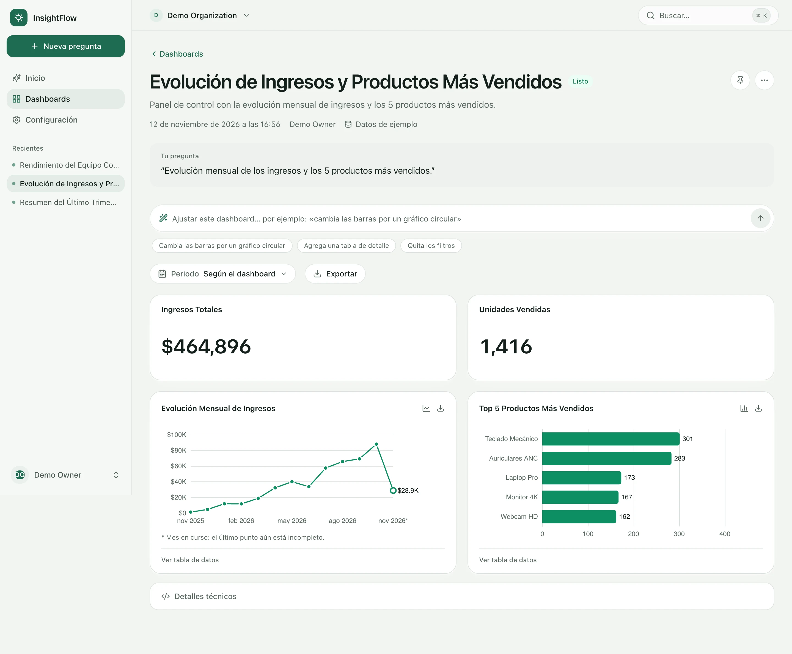
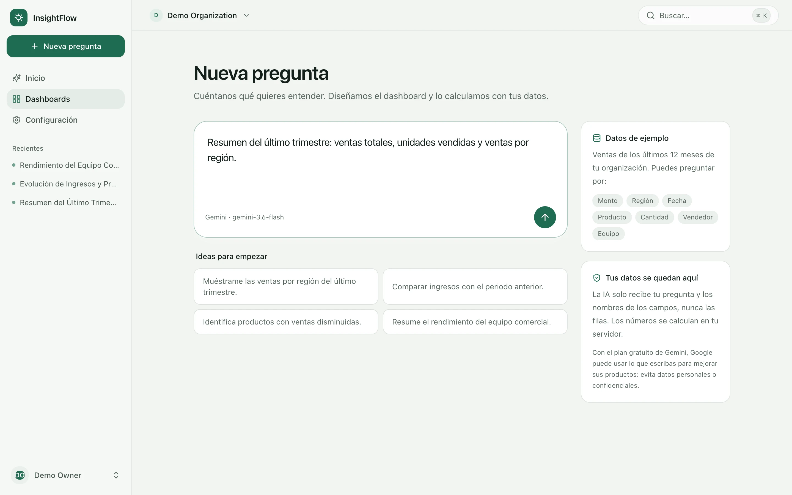
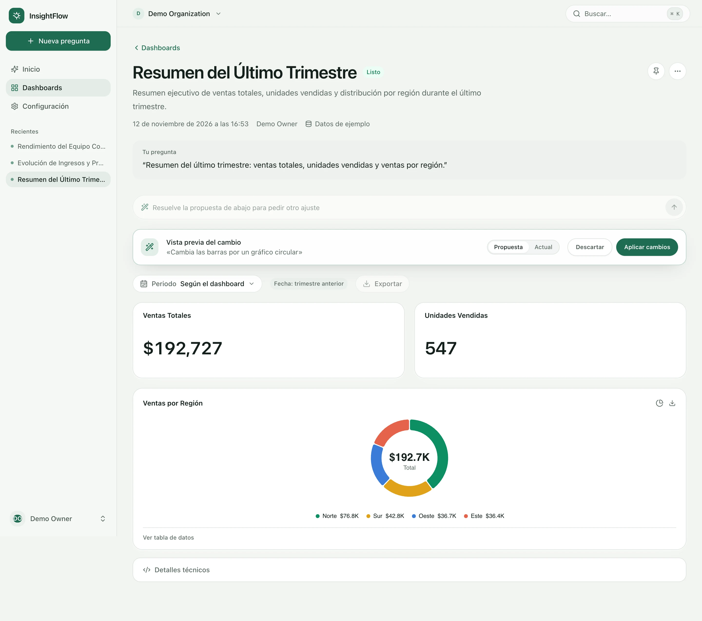
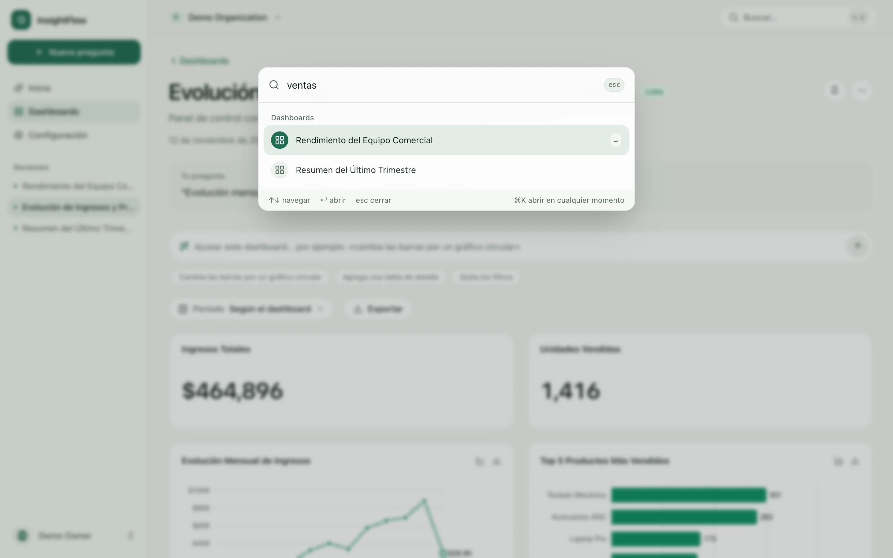
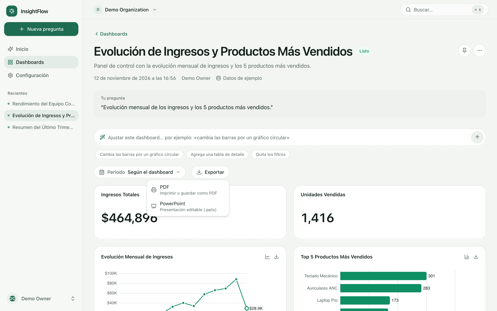
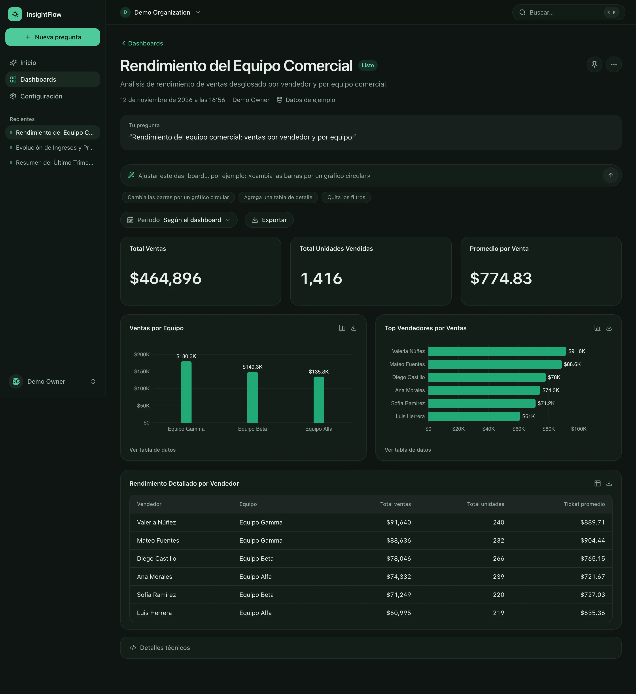
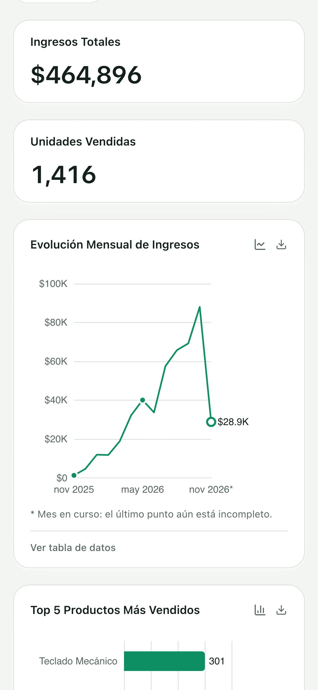
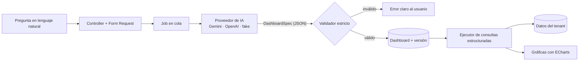

# InsightFlow

**Pregúntale a tus datos.** SaaS multi-tenant donde describes en lenguaje natural lo que quieres entender y la IA diseña el dashboard. Lo valida, calcula los números en tu propio servidor y te deja refinarlo, buscarlo y exportarlo.



> Proyecto de portfolio. Laravel 12 · PHP 8.4 · Vue 3 + TypeScript · Inertia · ECharts · Gemini / OpenAI.

## Qué puedes hacer

### 1. Preguntar en lenguaje natural

Escribes una frase y obtienes un dashboard con indicadores, gráficas y tablas. La IA solo recibe tu pregunta y los nombres de los campos disponibles, nunca las filas: los números se calculan en el servidor.



### 2. Refinar con IA, con vista previa y deshacer

Pides un cambio («cambia las barras por un gráfico circular») y la IA propone un dashboard nuevo. Lo comparas con el actual y decides si lo aplicas. Cada cambio queda como una versión que puedes restaurar.



### 3. Claro y oscuro, buscador y exportación

| Buscador `⌘K` | Exportar |
| --- | --- |
|  |  |



Funciona también en móvil:



## Cómo funciona



## Decisiones técnicas

- **La IA nunca escribe SQL.** Produce un `DashboardSpec` (JSON) que el
  `DashboardSpecValidator` comprueba contra un catálogo aprobado: lista de campos,
  sin HTML, referencias coherentes. Solo un spec válido se ejecuta, y el ejecutor lo traduce
  a consultas estructuradas con valores por _bindings_ e identificadores del catálogo.
- **Aislamiento por tenant en cada capa.** UUID en todos los recursos, `tenant_id`
  con clave foránea, Policies y un `CurrentTenant` que se revalida en cada petición.
  Un `tenant_id` enviado en el request se rechaza. Cada recurso nuevo lleva una
  prueba positiva y otra cross-tenant.
- **Proveedores intercambiables.** `fake` (determinista, para desarrollo y tests),
  `gemini` (plan gratuito de Google AI Studio) y `openai`, detrás de una misma
  interfaz. Un valor ausente o desconocido falla de forma explícita.
- **Refinar sin riesgo.** Un cambio pedido a la IA es una _propuesta_: no toca el
  dashboard hasta que se aplica. Las versiones son un historial _append-only_.
- **Trabajo lento fuera de la petición.** La generación y el refinamiento son Jobs
  idempotentes, con límite de generaciones por usuario y manejo de fallos del
  proveedor (saturación, límites, respuestas inválidas) con mensajes claros.
- **Exportación en el navegador.** PNG, CSV (protegido contra inyección de
  fórmulas), PDF y PowerPoint se generan en el cliente, sin enviar datos a terceros.
- **Calidad verificable.** 281 pruebas PHPUnit y 35 de Vitest, formato y análisis
  estático en el CI, migraciones comprobadas en PostgreSQL 17 y dependencias
  auditadas (`composer audit` sin avisos).

## Stack

| Capa | Tecnología |
| --- | --- |
| Backend | PHP 8.4, Laravel 12, monolito modular (`app/Domain`) |
| Frontend | Vue 3 (`<script setup>`, TypeScript), Inertia, Tailwind CSS |
| Gráficas | Apache ECharts (carga bajo demanda), `pptxgenjs` para PowerPoint |
| IA | Gemini y OpenAI tras la interfaz `DashboardGenerator` |
| Datos | PostgreSQL 17 (SQLite en tests), Redis para colas |
| Calidad | PHPUnit, Vitest, Pint, ESLint, Prettier, `vue-tsc`, GitHub Actions |

## Funcionalidades en detalle

- Autenticación, organizaciones y aislamiento explícito por tenant.
- Generación asíncrona de dashboards (cola + Job idempotente).
- Proveedores de IA intercambiables detrás de una interfaz: `fake`
  (determinista, para desarrollo y pruebas) y `openai`.
- Validación estricta del `DashboardSpec`: allowlist de campos, sin SQL, sin
  HTML, referencias cruzadas coherentes.
- Dataset demo `demo_sales` por organización (se siembra al registrarse, ver
  `TENANCY_SEED_DEMO_DATA`) y un ejecutor que traduce el spec validado a
  consultas estructuradas, sin SQL generado por la IA y siempre acotado al
  tenant actual.
- Gráficas reales (KPI, barras, línea, área, circular y tabla) con ECharts, en
  claro y oscuro, con vista de tabla accesible para cada gráfica.
- Proveedor Gemini (plan gratuito de Google AI Studio) además de `fake`/`openai`.
- Buscador `⌘K` / `Ctrl+K`: busca dashboards de tu organización, ejecuta acciones
  y convierte una frase en un dashboard nuevo.
- Acciones sobre dashboards: editar título y descripción, duplicar, eliminar,
  fijar como favorito (personal) y reintentar una generación fallida o atascada.
  Editar, duplicar y eliminar requieren rol de propietario o administrador.
- Filtro de periodo (últimos 30 días, este/anterior mes o trimestre, este año,
  últimos 12 meses, todo) que recalcula todas las visualizaciones en el servidor
  y viaja en la URL (`?period=`). Un periodo elegido reemplaza los filtros de
  fecha del dashboard; los filtros propios de cada visualización se conservan.
  El mes en curso se marca como incompleto en las tendencias.
- Refinar con IA: pide un cambio en lenguaje natural («cambia las barras por un
  gráfico circular»). La IA propone un dashboard completo que pasa por el mismo
  validador; se muestra como vista previa (propuesta o actual) y no se aplica
  hasta que lo aceptas. Cada cambio crea una versión: historial append-only con
  «deshacer», «volver al original» y restaurar cualquier versión.
- Exportar, todo en el navegador y siempre en tema claro: imagen PNG y datos CSV
  de cada gráfica; PDF del dashboard (impresión del navegador, A4 apaisado) y
  presentación PowerPoint (.pptx) con portada, indicadores, una diapositiva por
  gráfica (con texto alternativo) y tablas nativas editables. Los CSV protegen
  contra la inyección de fórmulas y se abren en Excel (UTF-8 con BOM).

## Arquitectura en breve

```text
Controller/Form Request -> StartDashboardGeneration -> Queue
GenerateDashboardJob -> DashboardGenerator -> DashboardSpecValidator
```

- Monolito modular bajo `app/Domain` (`Tenancy`, `Dashboards`, `Ai`, `Metabase`).
- El tenant se obtiene únicamente de `CurrentTenant`; nunca del request.
- El proveedor de IA se elige con `DASHBOARD_AI_DRIVER`. Un valor ausente o
  desconocido falla de forma explícita, sin fallback silencioso.
- El schema canónico del contrato está en
  [resources/schemas/dashboard-spec-v1.json](resources/schemas/dashboard-spec-v1.json).

## Requisitos

PHP 8.4, Composer 2, Node 22 (ver `.nvmrc`) y pnpm 10 (vía `corepack`).

## Inicio rápido con Docker

```bash
cp .env.example .env
docker compose build
docker compose run --rm app php artisan key:generate
corepack pnpm install --frozen-lockfile
corepack pnpm build
docker compose up -d
docker compose exec app php artisan migrate --seed
```

Aplicación: <http://localhost:8080>. Metabase: <http://localhost:3000>.
Las migraciones nunca se ejecutan al arrancar los contenedores.

Usuarios de demostración (sólo desarrollo local): `owner@example.test` y
`member@example.test`, ambos con la contraseña `password`.

## Comandos principales

```bash
# Dependencias en el host
composer install
corepack pnpm install --frozen-lockfile

# Pruebas (PHPUnit, SQLite en memoria)
composer test

# Formato y análisis
composer format
corepack pnpm format
corepack pnpm lint
corepack pnpm types

# Pruebas del frontend (Vitest: lógica pura de formato, gráficas y exportación)
corepack pnpm test:js

# Comprobaciones sin modificar archivos (las mismas que ejecuta el CI)
composer format:check
corepack pnpm format:check
corepack pnpm lint:check
corepack pnpm types
corepack pnpm build

# Servicios
docker compose up -d
docker compose ps
docker compose logs -f app worker web
docker compose down
```

## Despliegue en producción

`compose.prod.yaml` define el stack de producción en una sola máquina: Caddy con
HTTPS automático, PHP-FPM con el código y los assets ya incluidos en la imagen, el
worker de la cola, PostgreSQL y Redis (con contraseña, sin puertos publicados).

```bash
cp .env.production.example .env.production   # rellena los valores en el servidor
docker compose --env-file .env.production -f compose.prod.yaml build
docker compose --env-file .env.production -f compose.prod.yaml up -d
docker compose --env-file .env.production -f compose.prod.yaml run --rm app php artisan migrate --force
docker compose --env-file .env.production -f compose.prod.yaml run --rm app php artisan demo:install
```

Las migraciones nunca se ejecutan al arrancar los contenedores. `demo:install`
crea una cuenta de demostración con dashboards de ejemplo, con las credenciales
`DEMO_USER_EMAIL` y `DEMO_USER_PASSWORD` del entorno del servidor (no hay
contraseñas por defecto). Para limitar el gasto de una cuota gratuita de IA,
`DASHBOARD_AI_GLOBAL_PER_DAY` fija un tope diario compartido por todos los usuarios.

## Configuración de IA

```dotenv
DASHBOARD_AI_DRIVER=fake   # fake | gemini | openai

# Gemini (clave de Google AI Studio, sólo en .env local; nunca se versiona)
GEMINI_API_KEY=
GEMINI_MODEL=gemini-3.6-flash
GEMINI_TIMEOUT=60
GEMINI_MAX_RETRIES=2
GEMINI_MAX_OUTPUT_TOKENS=16384

OPENAI_API_KEY=
OPENAI_MODEL=gpt-5.6-terra
OPENAI_TIMEOUT=60
OPENAI_MAX_RETRIES=2
```

Tras cambiar el driver, la key o el modelo, reinicia el worker de la cola.

### Probar con Gemini (plan gratuito)

1. Crea una clave en [Google AI Studio](https://aistudio.google.com/).
2. En tu `.env` local: `DASHBOARD_AI_DRIVER=gemini` y `GEMINI_API_KEY=...`.
3. Reinicia el worker y crea un dashboard desde la app.

Notas: los límites del plan gratuito (peticiones por minuto y por día) cambian y
sólo se ven en el panel de AI Studio; al alcanzarlos la generación falla con un
mensaje claro y no se reintenta. Con el plan gratuito Google puede usar el
contenido enviado para mejorar sus productos, por eso la app sólo envía tu
solicitud y el catálogo estático (nunca filas, ids internos ni secretos) y avisa
en la pantalla de creación. Los nombres de modelo cambian con frecuencia:
comprueba el vigente en la documentación de Gemini antes de fijarlo.

## Dependencias del frontend añadidas con justificación

- `echarts` y `vue-echarts`: el framework no incluye gráficas. ECharts cubre los
  tipos del contrato (barras, línea, área, circular) con accesibilidad y
  tooltips; se importa por módulos y se carga de forma diferida.
- `pptxgenjs`: generar un `.pptx` real en el navegador no tiene equivalente en el
  framework. Solo depende de `jszip`, no tiene scripts de instalación y se carga
  de forma diferida únicamente al exportar a PowerPoint.
- `vitest` (desarrollo): no había runner para el frontend y la lógica de
  exportación (p. ej. el escapado de CSV contra inyección de fórmulas) es
  sensible y pura, ideal para pruebas unitarias.

